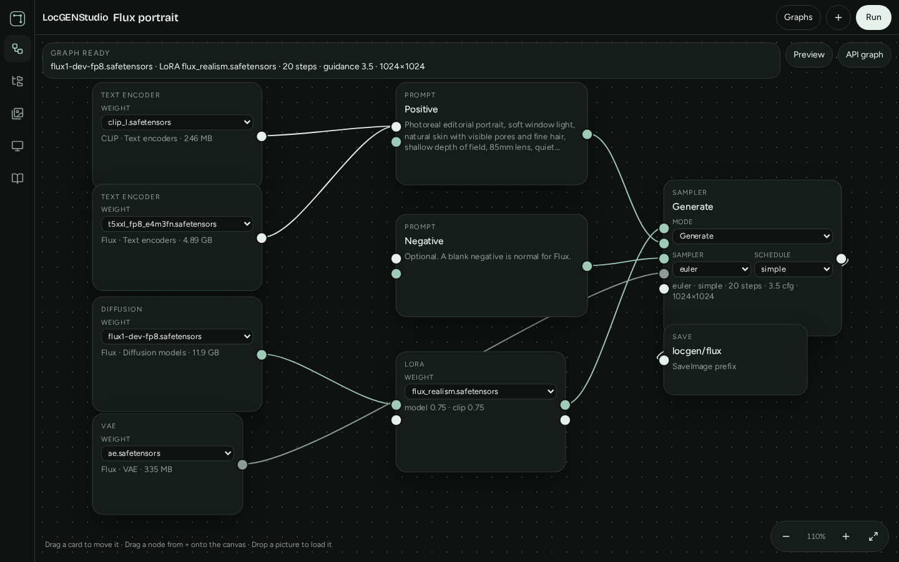
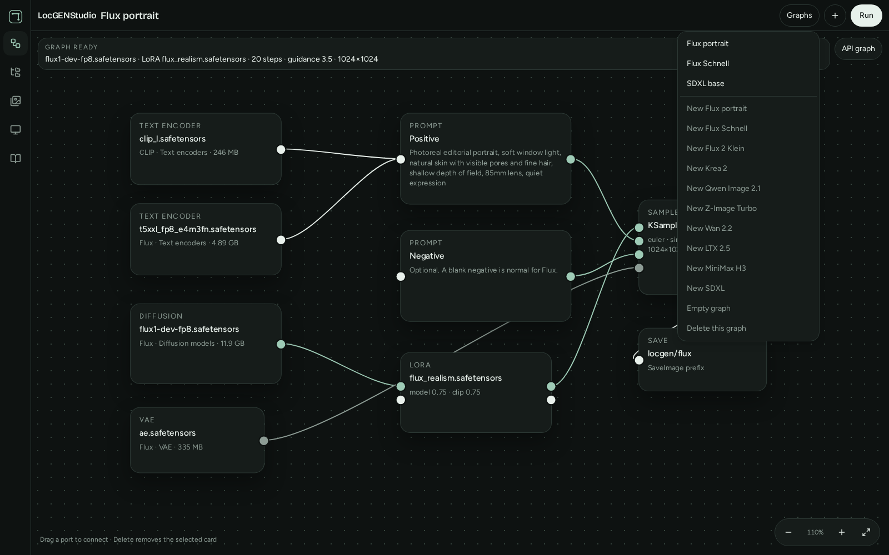
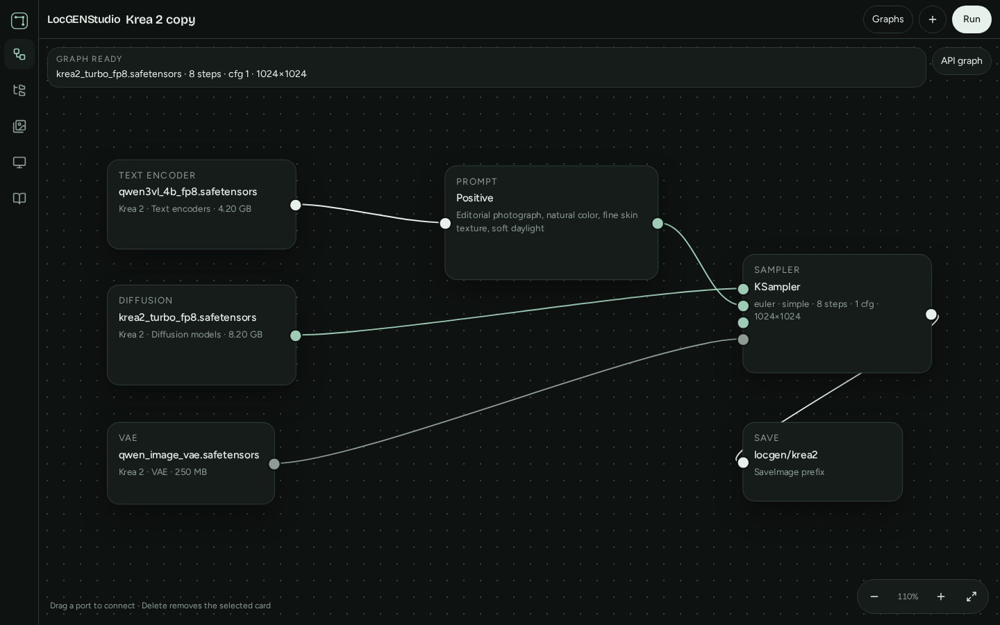
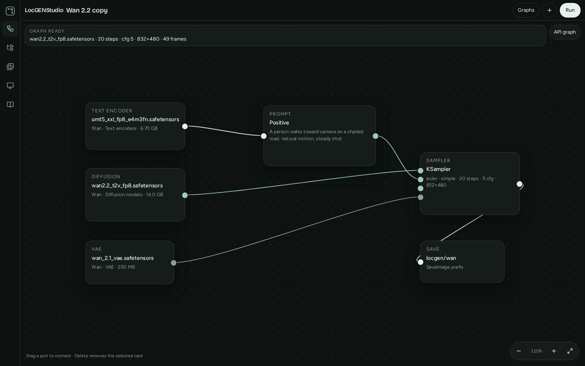
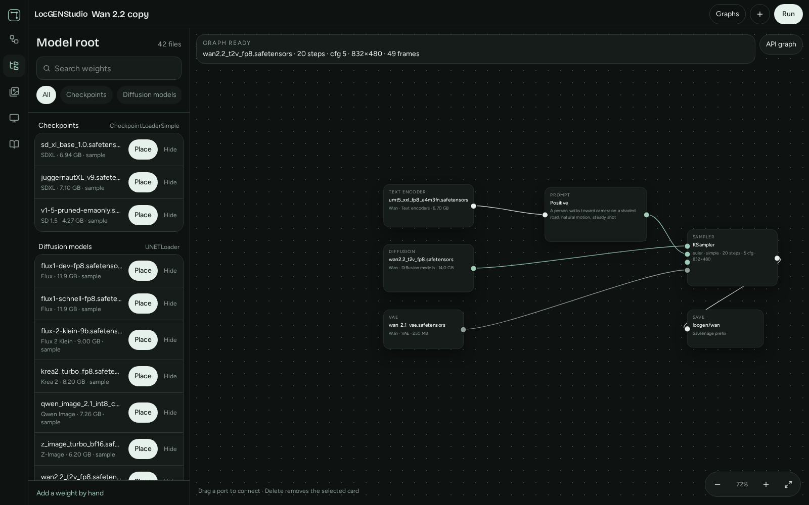
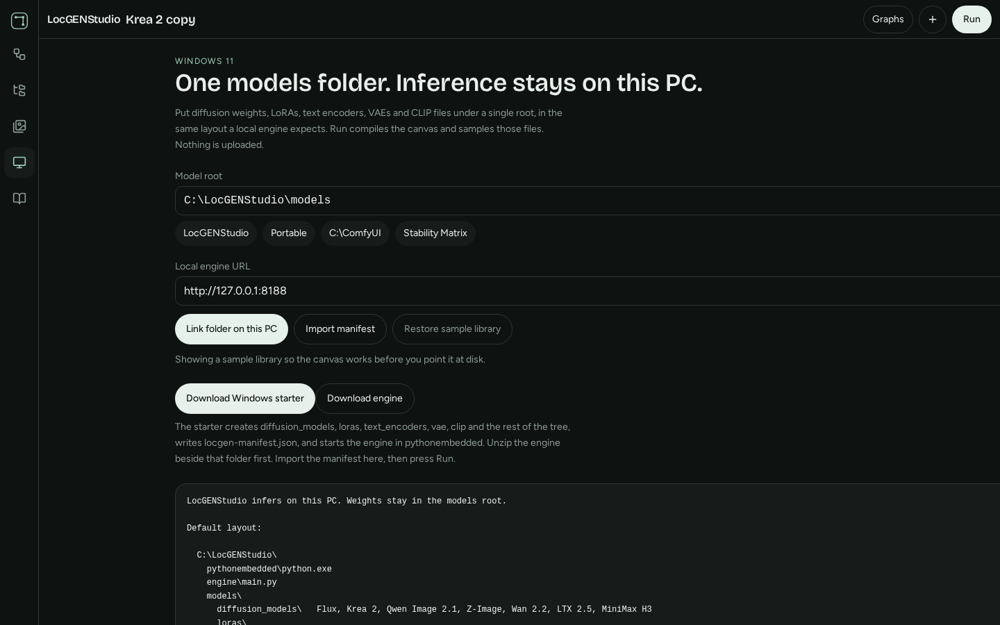

# LocGENStudio

**0.9.0.** A local generative studio for Windows 11.

You wire a graph on the canvas. The engine on this PC loads the weights you already have and samples on the GPU that `pythonembedded` can see. Diffusion models, LoRAs, text encoders, VAEs, and checkpoints stay in one models folder, in the same layout a local engine expects. The studio sends filenames and sampler settings. It does not upload the files. A browser preview cannot see the GPU. A real image shows up only after the starter is listening on this machine.

Built-in graphs cover Flux, Flux Schnell, Flux 2 Klein, Krea 2, Qwen Image 2.1, Z-Image, SDXL, SD 1.5, Wan 2.2, LTX 2.5, and MiniMax H3. Open **Graphs** and start from one of those instead of wiring the loaders by hand.

The Windows package for this version is [v0.9.0](https://github.com/vinodkvijayan/LocGENStudio/releases/tag/v0.9.0).

## Screenshots

**Flux portrait.** CLIP-L, T5-XXL, a LoRA, and a 1024 latent.



**Graphs.** Each family has a starting graph.



**Krea 2.** One Qwen3-VL encoder, the Krea diffusion file, and the Qwen image VAE.



**Wan 2.2.** A video latent: 832×480, 49 frames, UMT5, and the Wan VAE.



**Library.** Point the studio at a models root, then place a weight on the canvas.



**Windows.** The models root, the engine URL, and the starter.



## Edit a picture

Drop a picture on the canvas, or add an Image card and choose a file. Set the sampler dropdown to **Edit image**, **Inpaint**, or **Outpaint**, and wire the image into the sampler.

- **Edit** is img2img. Denoise is how far the model may move from the picture.
- **Inpaint** changes only the area you paint. Select the image card and paint in the inspector. Pale green is the mask.
- **Outpaint** grows the frame by the padding on the sampler, then fills the new area.

**Preview** opens the selected picture, or the latest result of this graph. A Preview card shows whatever image is wired into it. Drag a card to move it. Drag a node from **+** onto the canvas. Diffusion, LoRA, text encoder, VAE, and sampler cards have dropdowns for the file, the sampler, and the schedule.

A **Prompt enhancer** takes a system prompt, the prompt to rewrite, and an LLM model name. Point it at Ollama (`http://127.0.0.1:11434/v1`) or LM Studio (`http://127.0.0.1:1234/v1`). Wire its text output into a prompt. An optional image input is sent when the model can see pictures. The engine calls that server when you press Run.

**Graphs → New image edit** starts that layout. SDXL checkpoints are the reliable path for edit, inpaint, and outpaint. Other families need the matching img2img or inpaint class in the diffusers build inside `pythonembedded`.

## Layout

```
C:\LocGENStudio\
  pythonembedded\python.exe
  engine\main.py
  models\
    diffusion_models\
    loras\
    text_encoders\
    vae\
    clip\
    checkpoints\
  output\
```

`python_embeded` is accepted as well. That is the spelling used by some portable runtimes.

The default models root is `C:\LocGENStudio\models`. Output is the sibling folder `C:\LocGENStudio\output`.

## What a run actually does

1. You pick weights in the library, or import `locgen-manifest.json`.
2. The canvas compiles a prompt graph: loaders, text encode, latent, sampler, VAE decode, save.
3. The browser posts that graph to `http://127.0.0.1:8188`.
4. The engine loads the named files from the models root and samples.
5. The image comes back to Runs. The same PNG is written under `output\`.

Sample-library files are refused. A graph that still points at the built-in names will not be queued.

## Families

| Family | Kind of file | Text encoder | VAE |
|---|---|---|---|
| Flux | `diffusion_models` | CLIP-L and T5-XXL | `ae.safetensors` |
| Flux Schnell | same | same | same, 4 steps, CFG 1 |
| Flux 2 Klein | `diffusion_models` | one Qwen3 | `flux2-vae` |
| Krea 2 | `diffusion_models` | Qwen3-VL 4B | `qwen_image_vae` |
| Qwen Image 2.1 | `diffusion_models` | Qwen3-VL 8B | `qwen_image_2.1_vae` |
| Z-Image | `diffusion_models` | Qwen3 | Qwen image VAE |
| SDXL / SD 1.5 | `checkpoints` | inside the checkpoint | inside, or an override in `vae\` |
| Wan 2.2 | `diffusion_models` | UMT5-XXL | Wan video VAE |
| LTX 2.5 | `diffusion_models` | Gemma | LTX video VAE |
| MiniMax H3 | `diffusion_models` | Qwen3-VL for H3 | H3 video VAE |

Open **Graphs** for a starting graph of each family. Details, filenames, and step counts are in [docs/families.md](docs/families.md).

## Docs

| Guide | What it answers |
|---|---|
| [HOWTO.md](HOWTO.md) | First install through the first real image |
| [NOTES.md](NOTES.md) | Limits, licenses, VRAM, what is not sampled |
| [docs/models.md](docs/models.md) | Folder tree, aliases, the manifest |
| [docs/families.md](docs/families.md) | One section per model family |
| [docs/graph.md](docs/graph.md) | Nodes, ports, and how a graph is compiled |
| [docs/engine.md](docs/engine.md) | The Python process and the HTTP API |
| [docs/windows.md](docs/windows.md) | What the starter script does |
| [docs/troubleshooting.md](docs/troubleshooting.md) | Engine offline, missing files, bad jobs |

The same pages are in the studio under **Docs**.

## Requirements

- Windows 11
- A GPU that PyTorch in `pythonembedded` can use. CPU sampling is possible and slow.
- Inside `pythonembedded`: torch, diffusers, transformers, safetensors, accelerate, pillow. The list is `engine/requirements.txt`.
- A current diffusers for the newer families. Qwen Image 2.1, single-file Krea 2, and single-file MiniMax H3 need about diffusers 0.41. Older builds still compile the graph and return a clear error naming the missing pipeline.
- Edge or Chrome if you want to link the models folder directly. Any browser can import the manifest instead.

## First hour

Follow [HOWTO.md](HOWTO.md). Short form:

1. On the Windows tab, download the engine and unzip it so `engine\main.py` sits next to `pythonembedded`.
2. Download the starter and run it. It creates the models tree, writes `locgen-manifest.json`, and starts the engine.
3. Put weights in the folders. Run the starter again so the manifest includes them.
4. Import the manifest. Open a graph. Replace the sample names with your files. Press Run.
